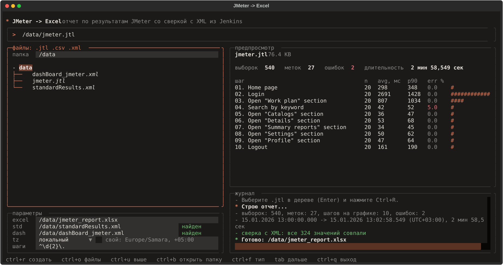

# JMeter -> Excel

Превращает результаты нагрузочного тестирования JMeter (файл `.jtl`, который выдает Jenkins)
в Excel-отчет: сводная таблица, график времени выполнения шагов, исходные данные и
сверка расчета с цифрами самого JMeter. Дополнительно: сравнение двух прогонов, проверка
порогов (SLA) с кодом выхода для Jenkins, экспорт в HTML и CSV.



## Возможности

- **Excel-отчет** по прогону. Это основной результат, и он не менялся: все новые функции
  пишут свои отдельные файлы рядом.
- **Терминальный интерфейс** с деревом файлов, предпросмотром и журналом. Выбирать можно
  любую папку, XML-файлы Jenkins подхватываются сами.
- **Сверка с XML из Jenkins**: каждое значение сравнивается с `standardResults.xml` и
  `dashBoard_jmeter.xml`; итог печатается в консоли и в журнале интерфейса. В Excel-отчет
  заказчика сверка не попадает.
- **Сравнение двух прогонов**: что стало лучше, а что хуже между "до" и "после". Отдельный
  файл `*_compare.xlsx` с подсветкой ухудшений.
- **Пороги и вердикт SLA**: "p90 шага не больше 2000 мс, ошибок не больше 1%". PASS/FAIL по
  каждому шагу и ненулевой код выхода, если пороги нарушены.
- **Экспорт в HTML и CSV** для тех, кому нужно просто открыть отчет в браузере.
- **Конфиг `report.toml`**: пояс, шаги, пороги, допуск сравнения и экспорт задаются один раз.
- **Формулы JMeter**: перцентили и среднее считаются так же, как в самом JMeter, поэтому
  цифры совпадают с дашбордом.
- **Большие файлы**: проверка SLA, сравнение и экспорт читают JTL потоком (в 10 раз меньше
  памяти, чем при чтении целиком).
- **Docker**: запуск без установки Python, образ публикуется в GitHub Container Registry.

## Быстрый старт

### Вариант 1: Docker (ничего ставить не нужно)

```bash
./report.sh ~/Загрузки            # интерфейс на любой папке
./report.sh                       # на текущей папке
```

Скрипт собирает образ при первом запуске и монтирует выбранную папку в контейнер как
`/data`. Отчет появится в этой же папке с вашим владельцем. Часовой пояс берется с машины
(можно задать так: `TZ=Europe/Moscow ./report.sh`).

Готовый образ из GitHub Container Registry, без сборки:

```bash
docker run --rm -it --user "$(id -u):$(id -g)" -v "$PWD:/data" ghcr.io/lunch418/jmeter-reporter
JMETER_REPORT_IMAGE=ghcr.io/lunch418/jmeter-reporter ./report.sh ~/Загрузки
```

Образ публикуется автоматически при каждом пуше в `main` (только если тесты прошли). При
первой публикации пакет приватный: сделайте его публичным в настройках пакета на GitHub,
если нужен доступ без входа.

Остальные команды в контейнере: `convert`, `cli`, `sample`.

```bash
docker run --rm --user "$(id -u):$(id -g)" -v "$PWD:/data" ghcr.io/lunch418/jmeter-reporter convert /data/jmeter.jtl /data/report.xlsx
docker run --rm --user "$(id -u):$(id -g)" -v "$PWD:/data" ghcr.io/lunch418/jmeter-reporter cli check /data/jmeter.jtl
docker run --rm --user "$(id -u):$(id -g)" -v "$PWD:/data" ghcr.io/lunch418/jmeter-reporter cli compare /data/old.jtl /data/new.jtl
```

Через Docker Compose (папка `./data` рядом с проектом):

```bash
docker compose run --rm report                        # интерфейс
docker compose run --rm report convert /data/jmeter.jtl /data/report.xlsx
docker compose --profile test run --rm test           # тесты
```

### Вариант 2: Python

Нужен Python 3.10 или новее (отчет, консольные команды и интерфейс).

```bash
python3 -m venv .venv
source .venv/bin/activate         # Windows: .venv\Scripts\activate
pip install -r requirements-tui.txt   # интерфейс + отчет (только отчет: requirements.txt)
python3 tui.py                    # интерфейс
```

## Интерфейс

```bash
python3 tui.py                    # в текущей папке
python3 tui.py ~/Загрузки         # в любой другой
```

| Область | Что делает |
|---------|------------|
| Строка с `>` | путь к `.jtl`; можно вписать руками или выбрать в дереве |
| Файлы | поле `папка` (любой путь) и дерево; по умолчанию видны `.jtl .csv .xml` |
| Параметры | куда сохранить `.xlsx`, XML для сверки, пояс, шаги, эталон и экспорт |
| Предпросмотр | сводка и таблица по шагам для файла, на котором стоит курсор |
| Журнал | ход построения, итог сверки, вердикт SLA и сравнение |

Выбрали JTL клавишей `Enter`: имя отчета подставилось, а лежащие рядом
`standardResults.xml` и `dashBoard_jmeter.xml` нашлись сами. Подпись поля показывает
состояние: `std +` файл найден, `std !` указан, но не найден, `std -` не используется
(так же для `dash`).

Поля, которых раньше не было:

- **эталон**: JTL "до изменений". Если он указан, рядом с отчетом появится
  `<имя>_compare.xlsx`, а в журнале итог сравнения. Выбрать его можно в дереве клавишей
  `Ctrl+E`.
- **экспорт**: `как в конфиге`, `только Excel`, `+ HTML`, `+ CSV`, `+ HTML и CSV`.
- Если найден `report.toml`, его значения подставляются (пояс, шаги), а после построения
  журнал показывает `SLA PASS` или `SLA FAIL` с нарушенными шагами.

Отчет по умолчанию сохраняется рядом с JTL (`<имя>_report.xlsx`). Исключения: демо-данные
из `samples/` и папки без права записи, в них отчет уходит в `reports/` текущей папки (или
в `output_dir` из конфига). Недостающие папки создаются сами. Служебные папки
(`__pycache__`, `venv`, `node_modules`, `*.egg-info`) в дереве скрыты.

| Клавиша | Действие |
|---------|----------|
| `Ctrl+R` или `Enter` в поле | построить отчет |
| `Ctrl+O` | перейти к дереву файлов |
| `Ctrl+U` | подняться в папку выше |
| `Ctrl+B` | сделать папку под курсором корнем дерева |
| `Ctrl+E` | взять файл под курсором как эталон для сравнения |
| `Ctrl+F` | фильтр файлов: `.jtl .csv .xml` или все |
| `Tab` / `Shift+Tab` | следующее / предыдущее поле |
| `Ctrl+Q` | выход |

## Командная строка

### Отчет: `convert.py`

```bash
python3 convert.py jmeter.jtl report.xlsx
python3 convert.py jmeter.jtl dashBoard_jmeter.xml standardResults.xml report.xlsx
python3 convert.py jmeter.jtl report.xlsx --standard standardResults.xml --tz Europe/Moscow
python3 convert.py jmeter.jtl report.xlsx --steps '^0[1-5]\.'
```

| Параметр | Значение |
|----------|----------|
| `--tz ЗОНА` | часовой пояс меток времени: `local` (по умолчанию), `UTC`, `Europe/Moscow`, `+05:00` |
| `--steps REGEX` | какие метки попадут на лист с графиком; по умолчанию `^\d{2}\.` (метки вида `01. Вход`) |
| `--standard ФАЙЛ` | `standardResults.xml` для сверки |
| `--dashboard ФАЙЛ` | `dashBoard_jmeter.xml` для сверки |
| `--config ФАЙЛ` | `report.toml` (по умолчанию берется из текущей папки, если он есть) |

В четырехаргументной форме файлы берутся по позициям: `jtl dashboard standard output`.

### Проверка, сравнение, экспорт: `cli.py`

```bash
python3 cli.py check   jmeter.jtl                     # вердикт SLA по report.toml
python3 cli.py compare old.jtl new.jtl                # что изменилось между прогонами
python3 cli.py export  jmeter.jtl --format html csv   # HTML и CSV
```

Коды выхода: `0` все хорошо, `1` SLA нарушен (`check`) или найдены ухудшения
(`compare --fail-on-regression`), `2` ошибка входных данных, файла или конфига, `3` внутренняя
ошибка программы (стектрейс в stderr: это баг, его не нужно путать с провалом SLA). `convert.py`
возвращает `0`, `2` или `3`. Поэтому команды
можно ставить прямо в сборку Jenkins: шаг упадет, если пороги не выполнены.

## Пороги и вердикт SLA

Пороги задаются в `report.toml` (пример: `report.example.toml`):

```toml
[sla]                    # для каждого шага
p90_ms = 2000
error_pct = 1.0

[sla.total]              # для строки TOTAL
error_pct = 2.0

[[sla.step]]             # шаг потяжелее получает свой порог
match = '^02\.'
p90_ms = 5000
```

Доступные пределы: `avg_ms`, `median_ms`, `p90_ms`, `p95_ms`, `p99_ms`, `max_ms`,
`error_pct` (значение не должно превышать предел) и `min_throughput` (запросов в секунду,
значение не должно быть ниже предела). По умолчанию проверяются только шаги (метки вида
`01. ...`), а подзапросы нет; `scope = "all"` проверяет все метки. Граница включается:
`p90 = 2000` при пределе 2000 проходит.

```
$ python3 cli.py check samples/jmeter.jtl --config report.example.toml
PASS  01. Home page          p90_ms     348 <= 2000
...
FAIL  04. Search by keyword  error_pct  5 <= 1
FAIL: проверено 21, нарушений 1
$ echo $?
1
```

Опечатка в имени предела (`p90ms`) или правило, под которое не подошел ни один шаг, дают
ошибку (код 2), а не молчаливое "все хорошо". Проверить конфиг можно командой
`python3 config.py report.toml`.

## Сравнение двух прогонов

```bash
python3 cli.py compare old.jtl new.jtl                       # результат: new_compare.xlsx
python3 cli.py compare old.jtl new.jtl --tolerance 5 --fail-on-regression
```

По каждому шагу и по TOTAL: average и p90 в обоих прогонах и изменение в процентах.
Строка помечается **хуже**, если average или p90 выросли больше допуска (по умолчанию
10%) или вырос процент ошибок; **лучше**, если упали больше допуска и ничего не ухудшилось;
иначе без изменений. Ухудшения подсвечены красным, улучшения зеленым. Шаги, которые есть
только в одном из прогонов, перечислены внизу листа. `--all-labels` сравнивает все метки,
а не только шаги.

Защита от шума: изменение считается только если оно больше допуска в процентах **и** не меньше
`--min-abs-ms` миллисекунд (по умолчанию 10: рост с 2 до 3 мс это +50%, но не регрессия), а
метки, где в любом из прогонов меньше `--min-samples` замеров (по умолчанию 5), не помечаются
вовсе. Обе настройки есть в `[compare]` (`min_abs_delta_ms`, `min_samples`).

## report.toml

```toml
[report]
timezone = "Europe/Moscow"      # local | UTC | Europe/Moscow | +05:00
steps = '^\d{2}\.'              # какие метки считать шагами
output_dir = "reports"          # куда класть отчеты, если путь не задан

[compare]
tolerance_pct = 10              # допуск сравнения прогонов
min_abs_delta_ms = 10           # меньший сдвиг в мс не считается изменением
min_samples = 5                 # метки с меньшим числом замеров не сравниваются

[export]
formats = ["html", "csv"]       # доп. файлы рядом с Excel-отчетом

[sla]
p90_ms = 2000
error_pct = 1.0
```

Файл берется из текущей папки (в интерфейсе еще и из открытой папки) или по `--config`.
Параметры командной строки сильнее конфига. Неизвестные разделы и ключи считаются
ошибкой, чтобы опечатка не осталась незамеченной. Для Python 3.10 используется пакет
`tomli` (ставится из `requirements.txt`).

## HTML и CSV

`cli.py export` (или поле "экспорт" в интерфейсе, или `[export]` в конфиге) пишет рядом с
отчетом:

- `<имя>.html`: один файл без внешних зависимостей, с таблицей по шагам, полосками времени
  и, если заданы пороги, вердиктом SLA и списком нарушений. Из браузера его можно
  распечатать в PDF.
- `<имя>.csv`: итоговая таблица (метка, выборки, average, median, p90, p95, p99, min, max,
  процент ошибок, throughput). Кодировка UTF-8 с BOM, Excel открывает ее правильно.

## История запусков

Новый отчет больше не затирает старый. Если файл уже есть, он переезжает в папку `history/`
рядом с ним под своей датой (`report_20261105_101530.xlsx`, то же для HTML, CSV и сравнения).
Каждый запуск дописывается в `history/journal.jsonl`: время, файл, выборки, ошибки, SLA,
регрессии. В интерфейсе журнал показывает `Ctrl+J`. Отключить: `keep_history = false` в
`report.toml`.

## Закрытый контур (без интернета)

Программа не обращается к сети. Три способа доставки: пакет с колесами
(`python tools/make_offline_bundle.py --with-tui --python-version 3.10`, один пакет на версию
Python; готовые лежат в Releases; потом `pip install --no-index
--find-links wheels -r requirements-tui.txt`), Docker-образ через `docker save` / `docker load`
или вообще без пакетов: `cli.py check`, `export` и `compare` работают на одном Python.
Подробности: [docs/OFFLINE.md](docs/OFFLINE.md).

## Какие JTL принимаются

Строго, без молчаливых нулей и подмен символов:

- **Формат:** CSV. XML-JTL отклоняется с подсказкой про `output_format=csv`.
- **Время:** `timeStamp` и `elapsed` должны быть целыми числами (миллисекунды, настройка JMeter
  `timestamp_format=ms`, она по умолчанию). Дата-формат вроде `2026/11/05 10:00:00` дает ошибку
  с номером строки, а не отчет за 1970 год.
- **Кодировка:** UTF-8 (BOM допускается). Для другой: `JTL_ENCODING=cp1251 python convert.py ...`.
- **Оборванный файл:** если JMeter убили посреди записи, последняя неполная строка пропускается
  с предупреждением. Битая строка в середине файла - ошибка с номером строки.
- **Колонка `success`:** без нее в отчете все замеры считаются ошибочными (с предупреждением),
  а проверка SLA с `error_pct` отказывает работать.
- **Метки и ответы** со знаком `=`, `+`, `-`, `@` в начале остаются текстом в Excel и CSV
  (формулы не выполняются).
- **Формулы:** медиана и перцентили считаются как в JMeter (`Math.round(n * p)`, половина вверх).

## Большие файлы

Excel-отчет держит весь JTL в памяти, потому что записывает его на лист "Исходные данные".
Для файлов выше 200 000 строк `convert.py` предупредит об этом и назовет оценку памяти (около
8 КБ на строку листа: на 400 тысячах строк это несколько ГБ). Лист можно не создавать:
`--no-raw-data` или `include_raw_data = false` в `report.toml` (остальные листы те же, файл
много меньше). Parquet не добавлялся намеренно: тяжелая зависимость, не нужная для задачи. Проверка SLA, сравнение и
экспорт читают файл построчно и хранят по одному числу на выборку. На JTL из 405 тысяч строк
(56 МБ) это около 43 МБ памяти против примерно 470 МБ при чтении целиком.

## Сверка с XML из Jenkins

Все числа отчета считаются из JTL. Если дополнительно передать XML из Jenkins, каждое
значение сравнивается с тем, что посчитал сам JMeter:

- `standardResults.xml`: samples, average, min, median, 90/95% line, max, error %
- `dashBoard_jmeter.xml`: average, median, 90/95% line. Этот файл не является валидным XML
  (теги вроде `<01. Home page>`), поэтому он читается отдельным разборщиком.

Результат показывается только в консоли и в журнале интерфейса (список расхождений и итог);
в Excel-отчете листа сверки нет. Метки сравниваются без учета пробелов по краям.
На реальном прогоне из 3640 строк совпали все 252 проверенных значения.

## Откуда взять файлы

Jenkins -> нужная сборка -> Artifacts. Скачайте:

| Файл | Нужен ли |
|------|----------|
| `jmeter.jtl` (может называться `jmeter (1).jtl`) | обязательно |
| `standardResults.xml` | для сверки |
| `dashBoard_jmeter.xml` | для сверки |

JTL должен быть в формате CSV: в JMeter включите
`jmeter.save.saveservice.output_format=csv`. Обязательные колонки: `timeStamp`, `elapsed`,
`label`; для процента ошибок нужна еще `success`.

## Что внутри Excel-отчета

1. **Сводка**: начало, конец и длительность теста; по каждой метке выборки, average, median,
   90/95/99% line, min, max, процент ошибок, throughput, прием и отправка KB/s; строка TOTAL.
2. **График времени**: таблица и горизонтальная диаграмма (Average и 90% Line) по шагам,
   выбранным через `--steps`.
3. **Исходные данные**: весь JTL (обрезается по лимиту строк Excel, с предупреждением).

Содержимое отчета закреплено тестом `tests/test_report_unchanged.py`: он сравнивает
отпечаток всех ячеек и упадет, если отчет изменится.

## Тестовые данные

Репозиторий содержит только **синтетические** данные: `samples/jmeter.jtl` создает
`tools/make_sample.py` (вымышленный хост `example.test`, фиксированный seed), вместе с
согласованными `standardResults.xml` и `dashBoard_jmeter.xml`.

```bash
python3 tools/make_sample.py samples/jmeter.jtl
python3 tools/make_sample.py slow.jtl --seed 9        # другой прогон для сравнения
python3 cli.py compare samples/jmeter.jtl slow.jtl
```

Реальные прогоны в репозиторий не добавляйте: `.gitignore` закрывает `*.jtl`, `*.xlsx` и
XML Jenkins везде, кроме `samples/`.

## Разработка

Правила и порядок релиза: [CONTRIBUTING.md](CONTRIBUTING.md). История версий: [CHANGELOG.md](CHANGELOG.md)
(SemVer, версия в `jmeter_reporter/version.py`, проверить: `python convert.py --version`).
Код лежит в пакете `jmeter_reporter/`. Запуск без установки: `python convert.py`; установка:
`pip install .` (команды `jmeter-report`, `jmeter-report-cli`, `jmeter-report-tui`).

```bash
pip install -r requirements-dev.txt
python3 -m pytest -q
```

Или в Docker (сборка падает, если тесты не проходят):

```bash
docker build --target test .
```

| Путь | Назначение |
|------|------------|
| `convert.py`, `cli.py`, `tui.py` | тонкие запускатели: `python convert.py ...` |
| `jmeter_reporter/` | весь код пакета (ставится и через `pip install .`) |
| `.../stats.py` | единственное место, где считаются цифры (гистограммы, потоковое чтение) |
| `.../jtl.py` | строгое чтение JTL: кодировка, оборванные строки, нечисловые поля |
| `.../convert.py` | Excel-отчет и командная строка отчета |
| `.../verify.py` | чтение XML Jenkins и сверка значений |
| `.../sla.py`, `compare.py`, `export.py` | вердикт, сравнение прогонов, HTML и CSV |
| `.../config.py`, `minitoml.py` | `report.toml` и запасной разбор TOML без пакетов |
| `.../history.py`, `workflow.py` | история запусков и все, что кладется рядом с отчетом |
| `.../timeutil.py`, `safety.py`, `errors.py` | часовые пояса, защита от формул, исключения |
| `.../preview.py`, `tui.py` | предпросмотр и терминальный интерфейс (Textual) |
| `tools/` | синтетические данные, снимок интерфейса, офлайн-пакет, заметки релиза |
| `tests/` | тесты (pytest, hypothesis) |
| `Dockerfile`, `docker-compose.yml`, `report.sh` | запуск в контейнере |
| `.github/workflows/` | тесты (`tests.yml`), образ (`docker.yml`), релиз по тегу `v*` (`release.yml`) |

## Если что-то не работает

- `ModuleNotFoundError: openpyxl`, `textual` или `tomli`: выполните
  `pip install -r requirements.txt` (в виртуальном окружении).
- "файл похож на JTL в формате XML": JTL сохранен как XML, переключите JMeter на CSV.
- Время в отчете не то: укажите зону (`--tz`, выбор в интерфейсе или `timezone` в конфиге);
  по умолчанию берется локальное время машины, в Docker это `TZ`.
- Интерфейс в Docker не видит нужные файлы: он показывает только смонтированную папку,
  запустите `./report.sh <папка с файлами>`.
- `Нет раздела [sla]`: создайте `report.toml` (скопируйте `report.example.toml`).
- `Ни одно ограничение SLA не применилось`: правила не подошли ни к одному шагу, проверьте
  `steps` и `match`.
- В журнале "сверка: расхождений N": откройте лист **Сверка**, строки с расхождениями
  стоят первыми.
